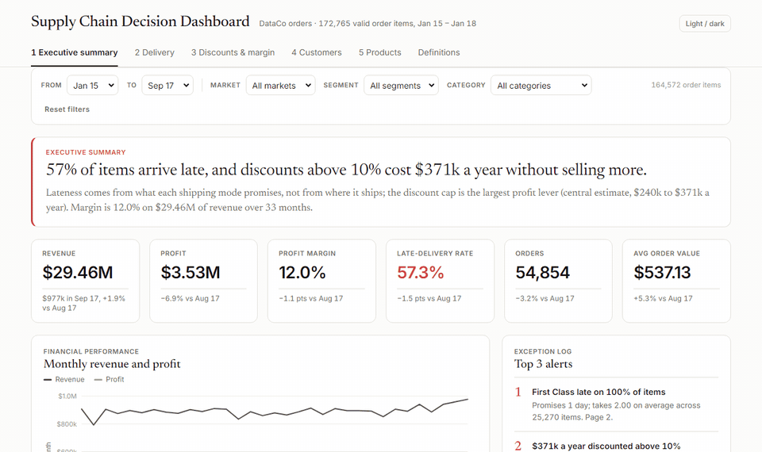
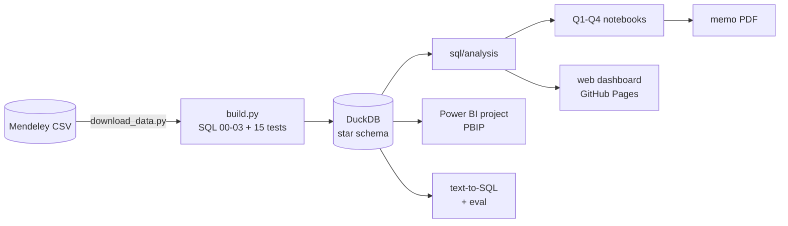

# Supply Chain Decision Dashboard

**Where is this retailer losing money and missing deliveries, and what should operations do about it?**
180,519 DataCo order items modelled into a DuckDB star schema with 15 data-quality rules, four business questions
answered with significance tests, a five-page BI dashboard with a discount-cap what-if, a one-page decision memo,
and an LLM text-to-SQL assistant with a 40-question execution-accuracy harness.

**[Live dashboard](https://ritik650.github.io/supply-chain-decision-dashboard/)** ·
**[Decision memo (PDF)](memo/decision_memo.pdf)** ·
[Notebooks](notebooks/) · [Data-quality log](docs/data_quality_log.md) · [KPI definitions](docs/kpi_definitions.md) ·
[Architecture](docs/architecture.md)



## Findings

Window: January 2015 – September 2017 (33 months), cancelled and suspected-fraud orders excluded. Every number
traces to a query in [`sql/analysis/`](sql/analysis/) and a notebook cell. Findings are associations, not causes.

| Question | Finding (number + comparison) | Decision | Where |
|---|---|---|---|
| Q1. What drives late deliveries? | The shipping mode's promise, not geography. First Class is late on **100%** of items (always 2 days against a 1-day promise); Second Class **79.8%**, and it ships no faster than Standard (3.99 vs 3.99 days, p = 0.85). Cramér's V: mode 0.48, next factor (region) 0.02. | Re-promise First Class at 2 days, Second Class at 4 (or make it faster): late rate **57.3% → 34.1%** with no operational change. | [Q1 notebook](notebooks/q1_delivery.ipynb) · page 2 |
| Q2. Where do discounts cut into margin? | Deeper discounts buy no volume: **2.18 vs 2.18** units per line above vs at or below 10% (within-product elasticity −0.006, 95% CI −0.057 to +0.044); margin 11.8% vs 12.1% (p = 0.29). One category (Women's Apparel) shows a real margin gap. | Cap discounts at **10%**: **$240k–$371k profit a year** (central $371k); pays unless more than 42% of capped volume is lost. Test in one market first. | [Q2 notebook](notebooks/q2_discounts.ipynb) · page 3 |
| Q3. Who are the valuable customers, and do they come back? | Champions are 19% of customers and 30% of revenue, but RFM does not predict the next order: scored to March 2017, segments reordered at **54–57%** over six months (Champions 54.2% vs Hibernating 55.5%, p = 0.45; AUC 0.49–0.50). Month-3 retention is a flat **12.7%**. | Don't fund RFM-targeted win-back; run one broad offer as a randomised holdout. +1 pt of monthly repeat rate ≈ **$100k profit a year**. | [Q3 notebook](notebooks/q3_customers.ipynb) · page 4 |
| Q4. Which products make the profit? | Profit is exactly as concentrated as revenue: the top 20% of products earn **96.1%** of profit and **96.1%** of revenue; **7** products earn 83% of profit; only **2** small products lose money. The 18.7% of loss-making lines are spread evenly (Cramér's V ≤ 0.02). | No delisting case. Product mix isn't the lever; discount policy is. Run the cap test on the 7 A-class products. | [Q4 notebook](notebooks/q4_products.ipynb) · page 5 |
| GenAI. How often is the text-to-SQL assistant right? | **Not measured yet**: the run needs an LLM API key. The harness is verified (40/40 when the "model" returns the gold SQL). | Run `make eval`; [results.md](genai/eval/results.md) is regenerated with the real number. | [genai/](genai/) |

## Data-quality catches

The build checks 15 rules on every run and logs the rows each one affects ([log](docs/data_quality_log.md)).
The ones that changed the analysis:

- **The market rotates with time.** In a typical month 89% of items go to one market, so "market" comparisons are
  really period comparisons. Late rates are tested *within* shipping mode for that reason.
- **The data changes regime in October 2017.** Orders drop from about 3 items to exactly 1, the catalogue switches,
  and 99% of buyers are new. Trends and cohorts stop at September 2017 instead of plotting a fake collapse.
- **The "6%" discount was applied at 5.5%** on all 10,029 of its rows. The build uses the rate actually applied.
- **Six column pairs are exact copies** (e.g. `Sales per customer` = `Order Item Total`), confirmed row by row
  before dropping one of each. "Order Profit Per Order" is item-level despite its name.
- **The file is latin-1, and DuckDB's latin-1 reader rejects it**, so the build transcodes to UTF-8 first.
- **Late flag:** `actual > scheduled` matches the source's `Late_delivery_risk` on every valid row; the 4,423
  mismatches are all cancelled shipments, which the KPIs exclude.

## How it works



Star schema at order-item grain: `fact_order_items` with `dim_date`, `dim_customer`, `dim_product`,
`dim_geography`, `dim_shipping` ([diagram](docs/architecture.md#star-schema)).

**Dashboard.** Five pages (executive summary, delivery, discounts, customers, products) plus definitions, with
the same global filters everywhere (date range, market, segment, category) and a takeaway line on every page.
It is a static site: valid order items ship to the browser as a 1.6 MB (gzipped) columnar file, so every filter
combination gives exact KPIs. [`scripts/check_dashboard.py`](scripts/check_dashboard.py) loads it headless and
confirms 39 default-view numbers equal the SQL. The Power BI version is a generated Power BI Project,
[`dashboard/powerbi/supply_chain_dashboard.pbip`](dashboard/powerbi/): TMDL model with 106 DAX measures and three what-if
parameters, and six PBIR report pages, checked against Microsoft's schemas and, in Power BI's engine, against the SQL.

**Text-to-SQL.** [`genai/ask.py`](genai/ask.py) puts the live schema, the KPI definitions and four worked examples
in the prompt; accepts only a single `SELECT` (DuckDB parser + keyword screen); runs it on a read-only connection
with file access disabled and a 5-second timeout; retries once with the error; and summarises from the result rows
only. [`genai/eval/`](genai/eval/) holds 30 test questions (10 easy, 10 medium, 10 hard) plus 10 fresh questions
held back for the score after one prompt revision.

```bash
python genai/ask.py "What was the late-delivery rate by shipping mode in 2016?"
```

## Run it

```bash
pip install -r requirements.txt
python scripts/download_data.py          # 96 MB from Mendeley, SHA-256 checked
python scripts/build.py                  # star schema + data-quality rules (~6 s)
python -m pytest tests -q                # 36 tests
python scripts/run_notebooks.py          # Q1-Q4, writes outputs/findings and outputs/figures
python scripts/export_dashboard.py       # dashboard data
python -m http.server -d dashboard/web   # open http://localhost:8000
python memo/build_memo.py                # memo PDF from the findings
```

Or `make all`. For the LLM evaluation, set `GEMINI_API_KEY` (free at Google AI Studio) or point
`SCDD_PROVIDER=openai` + `OPENAI_BASE_URL` at Groq, OpenRouter or a local Ollama model, then `make eval`.

## Repository

```
├── scripts/       download_data, build (one command), run_notebooks, export_dashboard, check_dashboard,
│                  make_demo_gif, make_pbip, validate_pbip
├── sql/           00_load → 01_staging → 02_dimensions → 03_fact; tests/ (15 rules); analysis/ (one file per number)
├── scdd/          shared paths, KPI constants, stats helpers, chart style
├── notebooks/     Q1-Q4 (executed) + src/ (diff-friendly sources)
├── outputs/       findings/*.json (numbers the memo cites), figures/
├── dashboard/     web/ (public dashboard, GitHub Pages), powerbi/ (Power BI project), screenshots/, demo.gif
├── memo/          decision_memo.pdf (+ .md), build_memo.py
├── genai/         ask.py, prompt.md, llm.py, eval/ (questions, run_eval, results.md)
├── docs/          data_quality_log.md (generated), kpi_definitions.md, architecture.md
└── tests/         warehouse rules + text-to-SQL safety and scoring
```

## Data and credits

DataCo Smart Supply Chain for Big Data Analysis: Constante, F., Silva, F., Pereira, A. (2019), Mendeley Data, v5,
[doi:10.17632/8gx2fvg2k6.5](https://doi.org/10.17632/8gx2fvg2k6.5), licensed CC BY 4.0. The data appears to be
synthetic (uniform shipping times, evenly rotated discount rates), which the analysis states rather than hides.
Dashboard layout started from a Google Stitch design.
