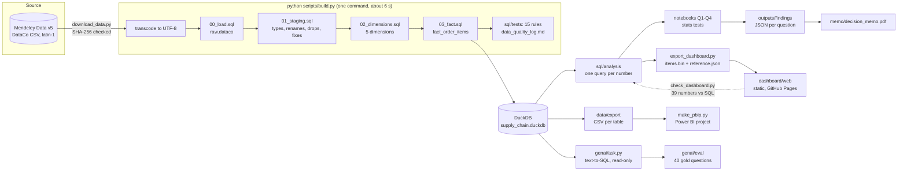
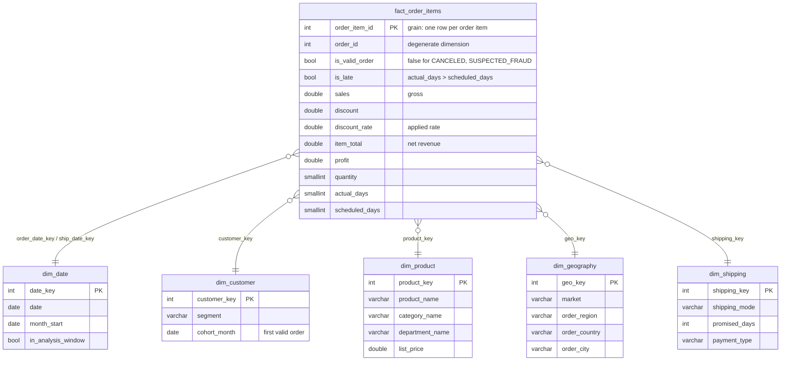

# Architecture

## Star schema

## Why these choices

- **DuckDB, one file, plain SQL in numbered files.** 180k rows build in about six seconds with no server; each
  step is a reviewable SQL file. dbt was left out on purpose: the plan's first cut when time is short.
- **Star schema at order-item grain.** Clear grain, reusable dimensions, simpler BI measures and a smaller,
  more legible schema for the text-to-SQL prompt. Order-level counts use `COUNT(DISTINCT order_id)`; rule T15
  checks that order-level attributes are constant across an order's items, so that count is well defined.
- **The KPI rules live in the fact table** (`is_valid_order`, `is_late`, `discount_rate`), so SQL, DAX,
  JavaScript and the LLM prompt cannot drift apart on what "revenue" or "late" means.
- **The web dashboard filters in the browser.** Valid order items ship as one 4.8 MB columnar binary
  (1.6 MB gzipped), so every filter combination gives exact KPIs, including distinct orders and cohorts,
  without a server. `scripts/check_dashboard.py` confirms its default-view numbers equal the SQL.
- **Text-to-SQL safety in three layers:** DuckDB's parser must see exactly one SELECT; a keyword screen blocks
  file-reading functions; the connection is read-only with external access disabled and its configuration
  locked. A watchdog interrupts any query after 5 seconds.
